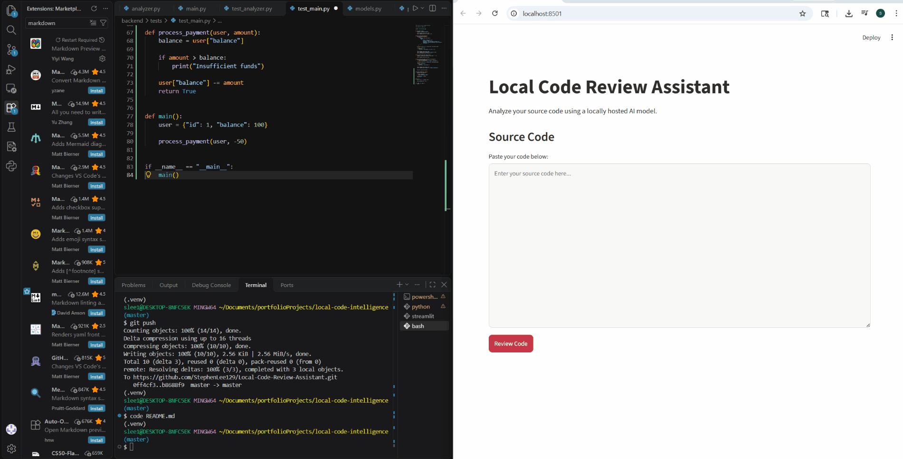
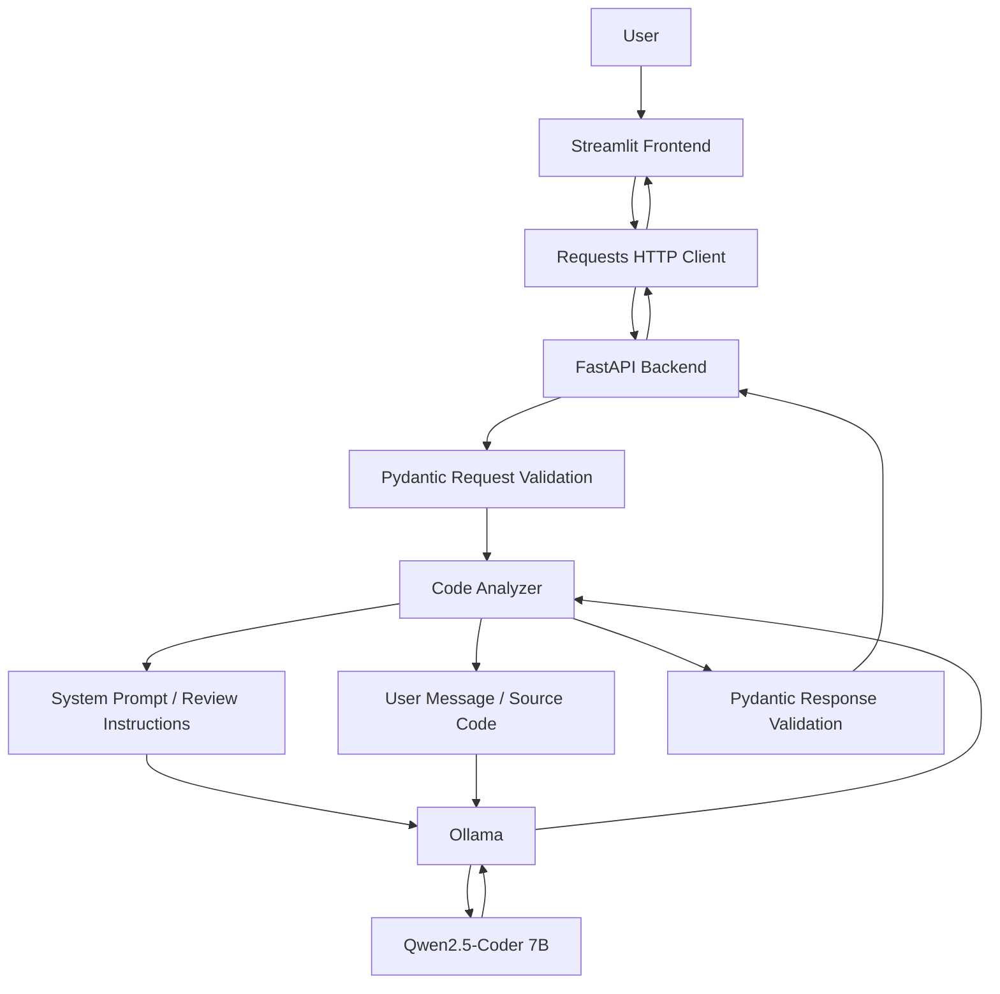

# Local Code Review Assistant

A locally hosted AI code review application powered by **Qwen2.5-Coder**, **Ollama**, and **FastAPI**. Submit source code through a simple web interface and receive structured feedback about potential bugs, security vulnerabilities, performance issues, and maintainability concerns.



**Want to run the application locally?** Follow the [Setup Guide](SETUP.md).

## Features

- **Local AI inference:** Analyze code using a locally hosted Qwen2.5-Coder model through Ollama.
- **Automated code reviews:** Identify potential bugs, security vulnerabilities, performance problems, and maintainability issues.
- **Structured feedback:** Receive findings with severity levels, explanations, suggested fixes, and approximate line numbers.
- **Simple web interface:** Submit code and review results through a Streamlit application.
- **Validated responses:** Use Pydantic models to enforce a consistent response structure.
- **Evaluation framework:** Measure review performance using precision, recall, and F1 score.

## Architecture

The application separates user interaction, API orchestration, and model inference. The frontend communicates with the backend over HTTP, while the backend handles validation and coordinates local model inference.

### High-level architecture



### Technology choices

| Technology | Responsibility | Why it was chosen |
|---|---|---|
| Python | Primary development language | Strong ecosystem for AI applications and backend development. |
| Streamlit | Frontend | Lightweight and quick way to build a simple interactive web interface using Python. |
| FastAPI | Backend API | Provides a lightweight API with automatic request validation and interactive documentation. |
| Pydantic | Data validation | Enforces consistent, explicit request and response structures. |
| Ollama | Local inference runtime | Popular runtime environment for running open-source LLMs |
| Qwen2.5-Coder 7B | Code analysis model | A code-focused language model selected for local code review experimentation. That works well on systems with tighter VRAM constraints. |
| Pytest | Automated testing | Verifies application behavior without requiring live model inference for every test. |

### Component breakdown

**1. Streamlit frontend — `frontend/app.py`**

Provides the user-facing interface. Users submit source code and view the resulting summary and findings.

The frontend communicates with FastAPI over HTTP rather than calling Ollama directly, keeping the presentation layer separate from model inference.

**2. FastAPI backend — `backend/app/main.py`**

Exposes the application's API endpoints. The `/review` endpoint accepts source code, validates the incoming request, invokes the analyzer, and returns a structured code review.

**3. Analyzer — `backend/app/analyzer.py`**

Coordinates model interaction. It sends the source code and review instructions to Ollama, receives the model response, and validates the returned JSON against the expected Pydantic schema.

This separates inference orchestration from the API endpoint itself.

**4. Prompt instructions — `backend/app/prompts.py`**

Defines how the model should conduct its review. The instructions encourage evidence-based findings, actionable suggestions, and consistent severity classifications while discouraging speculative issues.

**5. Pydantic models — `backend/app/models.py`**

Defines the application's data contracts:

- `CodeReviewRequest`: incoming source code.
- `CodeIssue`: an individual finding, including severity, explanation, suggestion, and optional line number.
- `CodeReview`: the overall summary and collection of findings.

Structured output makes the model's response predictable enough for the frontend to render consistently. A few advantages over a simple dictionary approach include defined structured representation, type validation, and clear I/O constraints.

**6. Ollama and Qwen2.5-Coder**

Ollama runs the model locally and exposes an API that the Python backend communicates with. Qwen2.5-Coder performs the actual code analysis.

Keeping inference behind Ollama allows the application to use a local model without depending on a hosted LLM API. Great for quick setup and allows for trying out different models down the line.

## Evaluation

A small evaluation framework was created to measure the quality of the application's code reviews and explore how prompt changes affect model performance.

### Evaluation approach

A reference code example is paired with a checklist of expected findings. Model-generated findings are compared against this reference to calculate:

- **Precision:** How many reported findings were expected?
- **Recall:** How many expected findings did the model identify?
- **F1 score:** A combined measure of precision and recall.

The current evaluation uses manually mapped findings rather than simple keyword matching.

### Example prompt comparison

The payment-processing example was used to compare two versions of the system prompt.

| Metric | Original prompt | Updated prompt |
|---|---:|---:|
| Precision | 66.7% | 100% |
| Recall | 40% | 80% |
| F1 score | 50% | 88.9% |

The updated prompt identified more expected issues and produced fewer unsupported findings in this example.

These results represent one manually evaluated example per prompt, not a comprehensive benchmark of model performance. However, it establishes the framework do so in the future.

### Running tests and evaluation

Run the automated test suite from the project root:

```bash
python -m pytest -v
```

To run the evaluation example:

```bash
python -m evaluation.run_evaluation
```

The tests cover API behavior, analyzer logic, Pydantic validation, and evaluation calculations.

## Project Structure

```text
Local-Code-Review-Assistant/
├── backend/
│   ├── app/
│   │   ├── analyzer.py
│   │   ├── main.py
│   │   ├── models.py
│   │   └── prompts.py
│   └── tests/
│       ├── test_analyzer.py
│       ├── test_main.py
│       └── test_models.py
├── evaluation/
│   ├── __init__.py
│   ├── evaluator.py
│   ├── payment_processing.py
│   ├── run_evaluation.py
│   └── test_evaluator.py
├── frontend/
│   └── app.py
├── docs/
│   └── demo.gif
├── requirements.txt
├── README.md
└── SETUP.md
```

## Limitations

- LLM-generated findings are not guaranteed to be correct or complete.
- Severity classifications are model judgments and may vary between runs.
- Approximate line numbers produced by output may not always be accurate.
- The evaluation framework currently relies on manually mapping findings to expected issues.

## Future Improvements

- Support programming language specification for better context and larger code submissions.
- Improve evaluation coverage with a broader collection of reference examples.
- Compare different local models and inference configurations.
- Explore additional inference runtimes beyond Ollama.
- Improve the interface with richer code review navigation and presentation.

---

Built as a portfolio project exploring local LLM inference, structured AI applications, backend/frontend integration, and practical evaluation of AI-generated results.